# DesignVault — Creative Project Portfolio Manager

> **Module:** IT3133(P) — Mobile Computing & Cloud Applications (ICA 03)  
> **Project type:** Individual university coursework  
> **Stack:** React Native · Expo SDK 58 · Expo Router · SQLite  

---

## Problem Description

Graphic designers and creative students often manage several designs at once. Keeping project details, artwork versions, colour references, feedback, tasks, and deadlines in different apps or folders makes it difficult to track progress and present a complete portfolio. Cloud-based tools can also be inconvenient when internet access is limited.

## Proposed Solution

**DesignVault** is an offline-first mobile portfolio manager that brings creative projects and their supporting materials into one organized workspace. Users can catalogue projects, attach multiple artworks, save brand colours, record critiques, track tasks and deadlines, and review their portfolio without a cloud account or backend server.

## Key Features

- **Project Catalog & Showcase** — Create, view, edit, and delete projects with titles, descriptions, categories, software tags, dates, and status.
- **Multiple Artwork Gallery** — Save multiple images per project and view them in a swipeable, full-screen gallery with zoom.
- **Colour Palette Manager** — Manage named HEX colour swatches and copy colour codes to the clipboard.
- **Design Task Checklist** — Add design deliverables, check off completed tasks, and monitor percentage progress.
- **Project Notes & Critiques** — Record ideas, feedback, revisions, and general notes.
- **Design Deadline Tracker** — Assign optional deadlines; view upcoming, due-today, overdue, and completed indicators; see deadlines on the Home screen and sort projects by deadline.
- **Dynamic Categories** — Create and rename categories, reassign associated projects, and safely delete categories.
- **Favourites & Search** — Star important projects and search, filter, or sort the portfolio.
- **User Profile** — Store a local display name and avatar and view portfolio statistics.
- **Three Themes** — Light, Dark, and Midnight Purple, including matching Android system-bar appearance.
- **Offline Storage** — Keep project records in SQLite and artwork files in local app storage.


## 📱 Application Screenshots

### 🏠 Home Dashboard & Project Gallery

| Home Dashboard | Project Gallery | Categories |
|:---:|:---:|:---:|
| 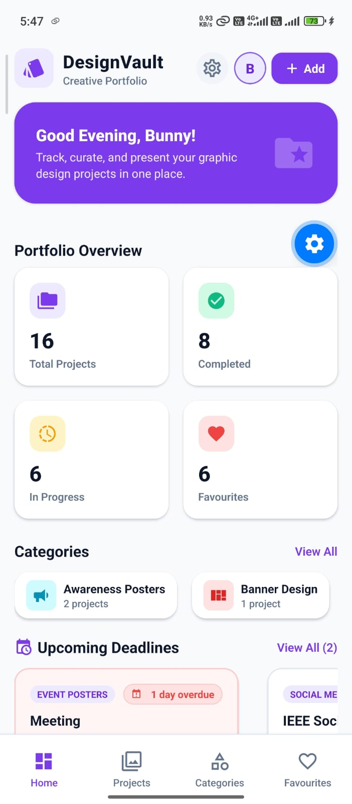 | 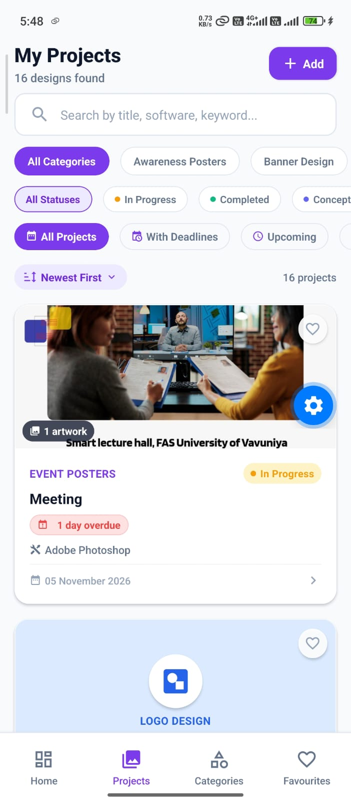 | 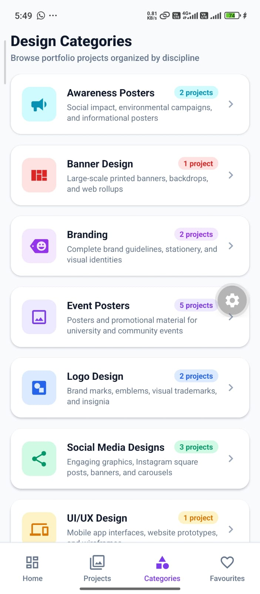 |

### 📝 Project Management

| Add Project | Project Deadline | Project Details |
|:---:|:---:|:---:|
| 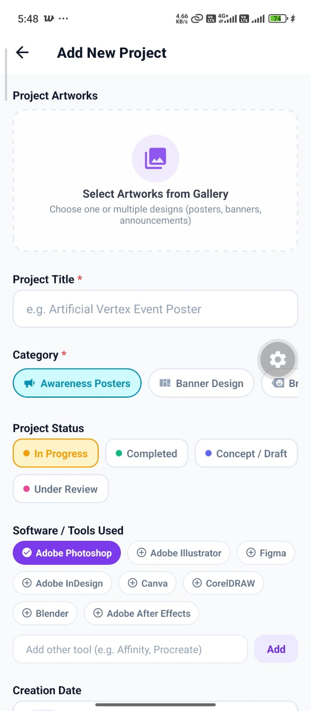 | 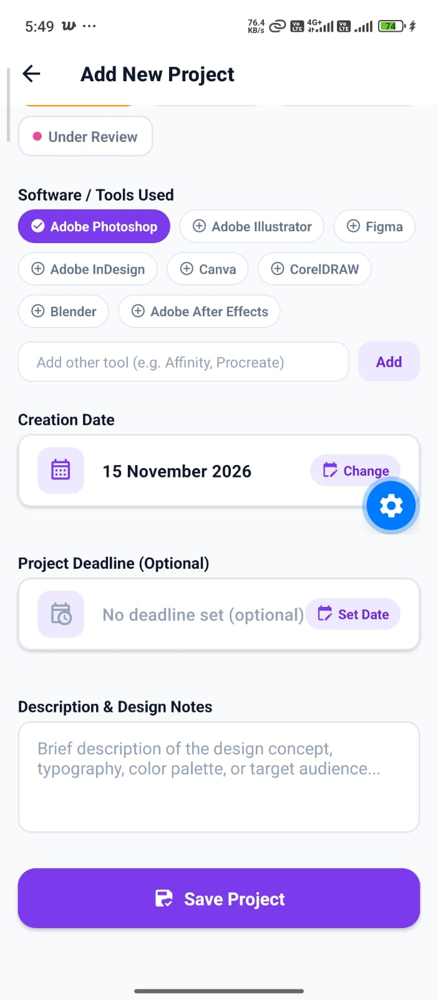 | 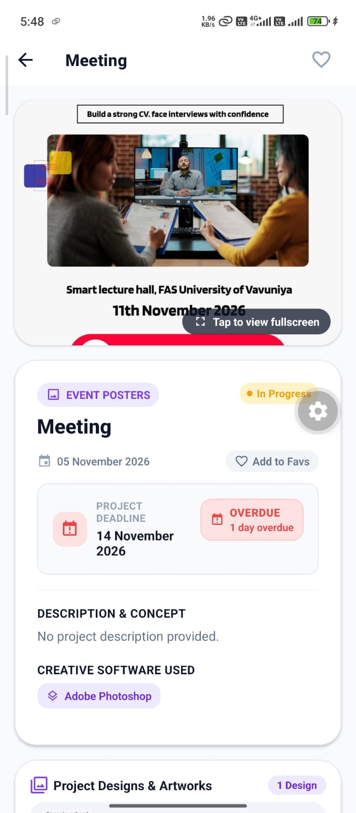 |

### 🎨 Creative Tools

| Artworks & Tasks | Colour Palette & Notes | Add Colour |
|:---:|:---:|:---:|
| 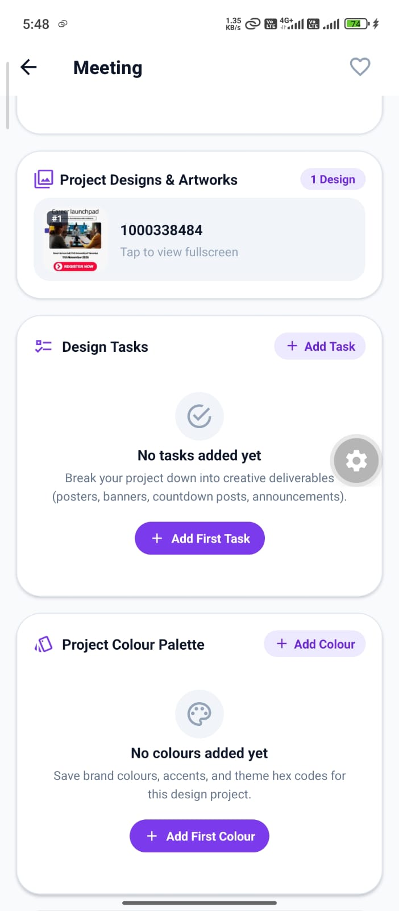 | 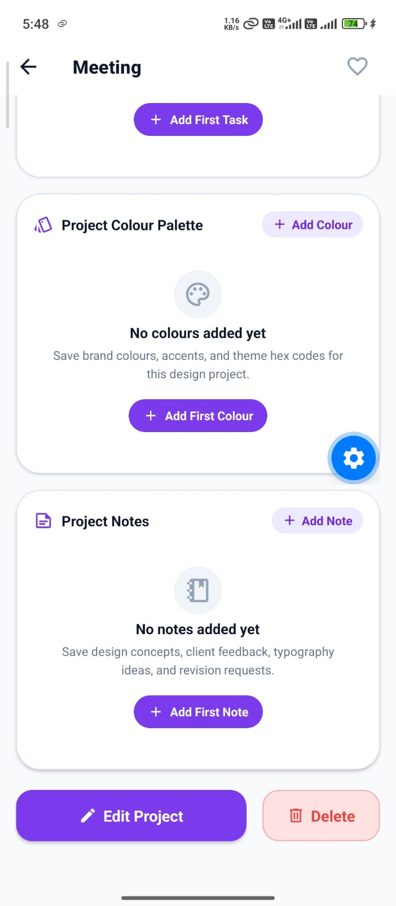 | 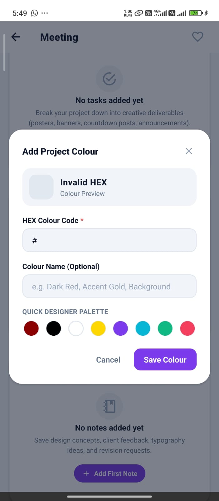 |

### 📅 Deadline Tracker & Favourites

| Deadline Dashboard | Favourite Designs |
|:---:|:---:|
| 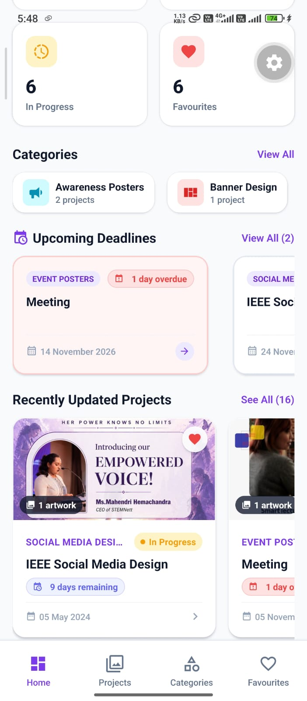 | 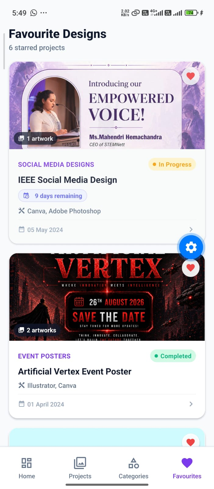 |

### 👤 Profile & Personalization

| My Profile | Application Settings |
|:---:|:---:|
| 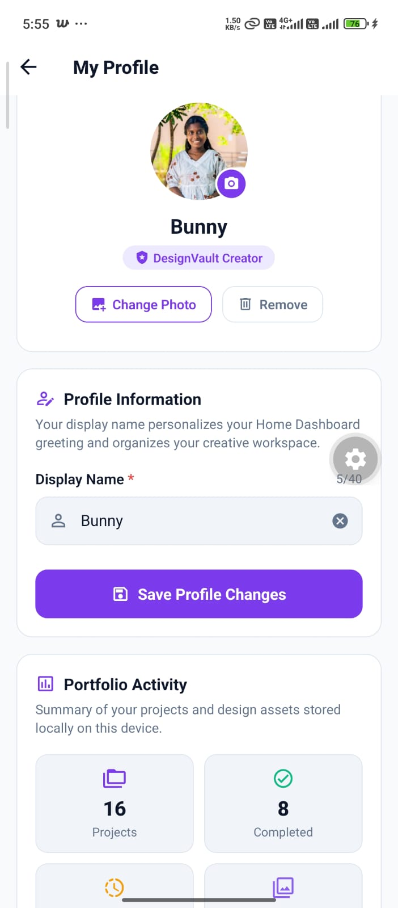 | 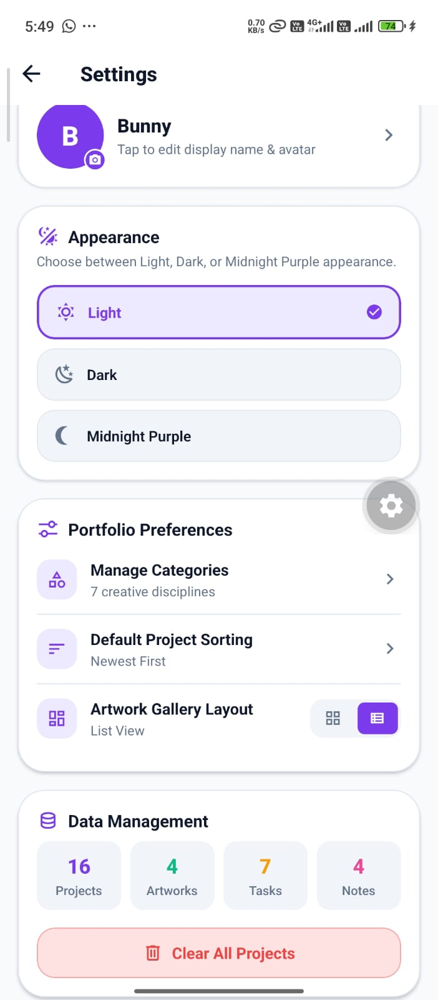 |

---

## Technologies Used

| Layer / Purpose | Technology |
| --- | --- |
| Mobile framework | React Native `0.88.1` |
| Development platform | Expo SDK `~58.0.25` |
| Navigation | Expo Router `~58.0.31` |
| Language | JavaScript / JSX |
| Local database | `expo-sqlite` `~58.0.17` |
| Artwork selection | `expo-image-picker` |
| Local file management | `expo-file-system` |
| Date selection | `@react-native-community/datetimepicker` `9.2.1` |
| Colour-code copying | `expo-clipboard` |
| Icons | `@expo/vector-icons` |
| Android navigation-bar appearance | `expo-navigation-bar` |
| Version control | Git and GitHub |

> Package versions above are based on the supplied DesignVault documentation. The repository's current `package.json` and lockfile are the authoritative sources if versions change.

---

## Setup Instructions

### Prerequisites

- Node.js and npm (use a supported Node.js LTS release)
- Git
- A compatible Android or iOS device with Expo Go, or a configured emulator/simulator
- Internet access for the initial clone, dependency installation, and development tooling

### 1. Clone the repository

```bash
git clone https://github.com/Thusa-02/DesignVault.git
cd DesignVault
```

### 2. Install dependencies

```bash
npm ci
```

`npm ci` uses the committed `package-lock.json` for a reproducible installation. If installation fails, inspect the reported dependency conflict and the repository's npm configuration rather than assuming all conflicts are harmless.

### 3. Check Expo compatibility

```bash
npx expo install --check
npx expo-doctor@latest
```

These commands check dependency compatibility and project configuration. The exact number of passing checks can vary with tool versions and the current project state.

### 4. Start the app

```bash
npx expo start
```

### 5. Run on a device

**Android:** Install a compatible version of Expo Go, connect the phone and computer to the same Wi-Fi network, then scan the QR code from Expo Go.  
**iOS:** Use the Camera app to scan the QR code and open it in Expo Go, where supported.  
**Android emulator:** Start the emulator, then press `a` in the Expo terminal.  
**iOS simulator:** On macOS with the simulator configured, press `i`.

If the local network prevents a connection, try:

```bash
npx expo start --tunnel
```

> The app's portfolio features work offline after setup; installing dependencies and connecting a development build may still require network access.

---

## How the System Works

1. **Open DesignVault** and complete the initial profile setup if prompted.
2. **Create a project** with a title, category, status, description, and optional deadline.
3. **Add artwork images** from the device gallery; files are kept in the app's local storage.
4. **Organize the design** using HEX colour swatches, a task checklist, and critique notes.
5. **Track progress** using project status, checklist completion, and deadline indicators.
6. **Browse the portfolio** using search, category filters, favourites, and sorting.
7. **Customize the app** with a profile picture and Light, Dark, or Midnight Purple theme.
8. **Return later** to find saved project data locally without signing in to a cloud service.

---

## Application Screens

| Screen | Main purpose |
| --- | --- |
| Home | Greeting, portfolio statistics, recent projects, and upcoming deadlines |
| Projects | Project gallery, search, filters, sorting, and grid/list presentation |
| Categories | Browse and manage creative project categories |
| Favourites | View starred projects |
| Add Project | Create a project, choose artwork, and set dates |
| Project Details | View artwork, deadlines, colour palettes, tasks, and notes |
| Edit Project | Update project information and artwork |
| Profile | Change display name/avatar and view portfolio statistics |
| Settings | Choose theme, sorting/layout preferences, and manage app data |

## Project Structure

```text
DesignVault/
├── app/
│   ├── _layout.jsx
│   ├── onboarding.jsx
│   ├── profile.jsx
│   ├── settings.jsx
│   ├── manage-categories.jsx
│   ├── (tabs)/
│   │   ├── _layout.jsx
│   │   ├── index.jsx
│   │   ├── projects.jsx
│   │   ├── categories.jsx
│   │   └── favorites.jsx
│   └── project/
│       ├── [id].jsx
│       ├── add.jsx
│       └── edit/[id].jsx
├── assets/
├── components/
├── constants/
├── context/
├── database/
├── hooks/
├── services/
├── package.json
└── package-lock.json
```

> This structure reflects the supplied project documentation; check the latest repository tree if routes or filenames have changed.

---

## SQLite Database Architecture

DesignVault uses a local SQLite database (`designvault.db`) and stores artwork images in the application's file sandbox. The supplied architecture describes **Write-Ahead Logging (WAL)** and enabled foreign-key constraints.

| Table | Purpose |
| --- | --- |
| `projects` | Core project information, including optional `deadline_date` |
| `project_artworks` | Multiple images belonging to a project |
| `project_colors` | Saved HEX colours for each project |
| `project_tasks` | Checklist items and completion flags |
| `project_notes` | Ideas, feedback, revisions, and general notes |
| `categories` | Default and user-defined categories |
| `user_preferences` | Local profile and app settings |

**Relationships:** Projects have one-to-many relationships with artworks, colours, tasks, and notes. Related rows are designed to be removed with cascading foreign-key deletion when a project is deleted.

**Deadline field:** `projects.deadline_date` is optional and stores a date in `YYYY-MM-DD` format. Deadline calculations use local calendar dates to avoid misleading day counts caused by UTC conversion.

---

## Feature Testing Guide

Use the following manual checks when reviewing the application:

| Test | Action | Expected result |
| --- | --- | --- |
| Create project | Add a title, category, and description | Project appears in the gallery |
| Edit project | Change project details | Updated details persist |
| Add artworks | Select multiple images | Images appear in the project gallery |
| Gallery viewer | Open, swipe, and zoom artwork | Artwork navigation and zoom work |
| Favourite | Star a project | Project appears in Favourites |
| Colour palette | Add a HEX swatch and tap to copy | Swatch is saved and code is copied |
| Checklist | Add and complete tasks | Progress percentage updates |
| Notes | Add an Idea or Feedback note | Note is saved and can be edited |
| Deadline | Set a future, current, or past date | Appropriate deadline indicator appears |
| Deadline editing | Change or clear a deadline | Updated value persists |
| Category management | Rename a custom category | Associated projects remain correctly categorized |
| Theme | Switch between all three themes | Screens and navigation remain readable |
| Offline access | Open saved projects without internet | Existing local data remains accessible |
| Persistence | Restart the app | Saved data and preferences remain available |

### Suggested validation commands

```bash
npx expo install --check
npx expo-doctor@latest
npx expo start
```

**Diagnostic status:** The supplied project summary reports that Expo Doctor passed **20/20 checks**. This README does not independently verify that run; attach the latest terminal output or rerun the command before submitting a final test claim.

---

## Troubleshooting

### Dependency installation fails

Confirm that `package.json` and `package-lock.json` are both committed and synchronized. Use `npm ci` in a fresh clone and inspect the error output. Avoid using `--legacy-peer-deps` merely to hide unresolved version conflicts.

### Expo Go cannot connect

Make sure the phone and computer are on the same Wi-Fi network. Check firewall restrictions or try `npx expo start --tunnel`.

### Metro cache causes stale behaviour

```bash
npx expo start -c
```

### Date picker shows a deprecation warning

Review the installed DateTimePicker version and update deprecated callback usage according to that version's supported API. Verify date selection, cancellation, and deadline removal afterward.

### Data does not appear after reinstalling

SQLite data is stored locally in the app installation, not in GitHub. Uninstalling the app or clearing its storage can remove local records; avoid clearing app data when you need to preserve projects.

---

## Academic Information

|    Field     |                      Detail                       |
| ------------ | ------------------------------------------------- |
| Project      | DesignVault — Creative Project Portfolio Manager  |
| Module       | IT3133(P) — Mobile Computing & Cloud Applications |
| Assessment   | ICA 03                                            |
| Project type | Individual coursework                             |
| Year         | 2026                                              |

## License & Academic Use

Developed as an individual academic project. All rights reserved unless a separate license is added to the repository.
